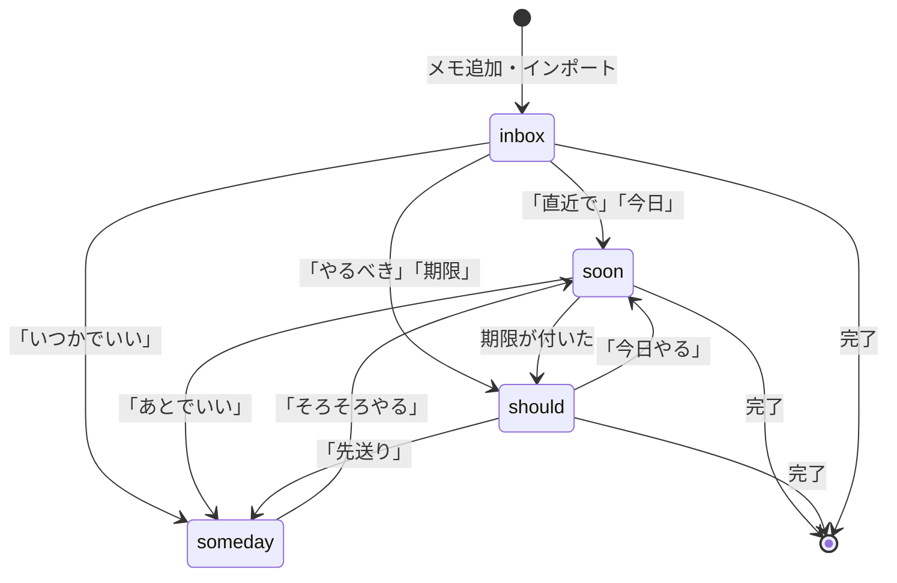
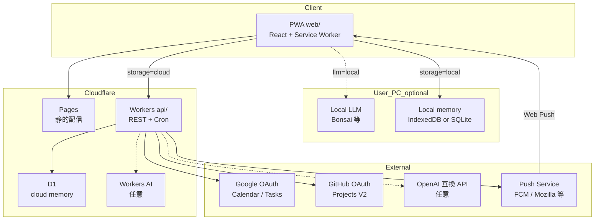
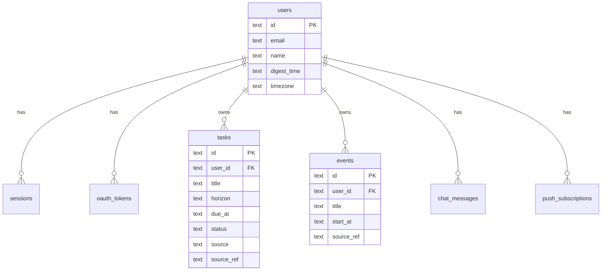
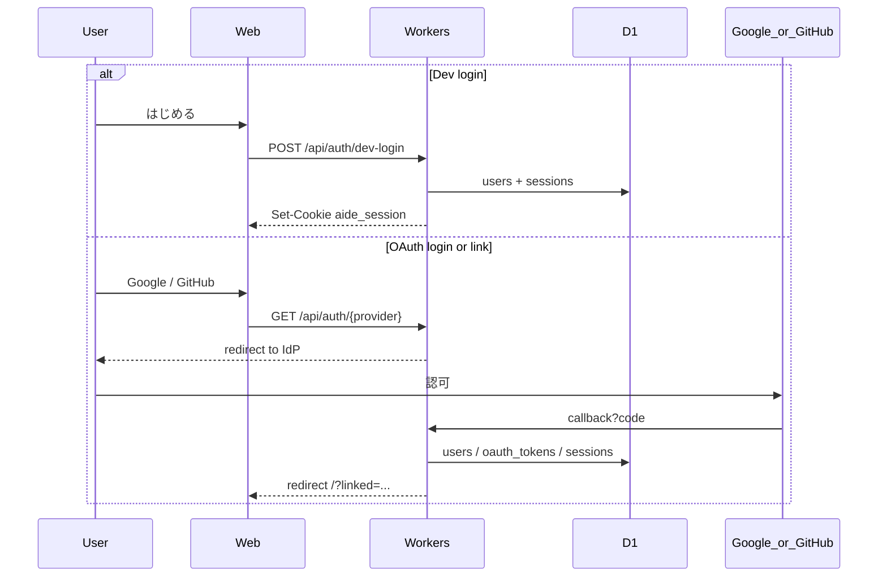
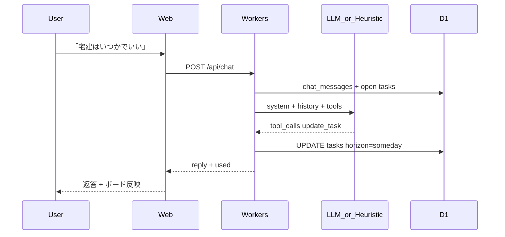
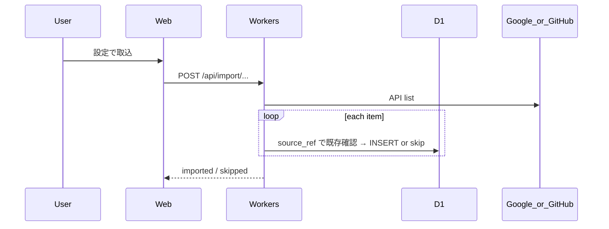

# Aide

**暮らしのアシスタント**（Aide = 補佐・助手）。話すだけで、やることを整える。

この README が MVP の仕様正本。実装は `api/` · `web/` を参照。

---

## 1. 原則

- **話すだけで整える** — 主入力は自然言語。画面はいまやることを確認する場
- **いま何をすべきか** — 画面・返答とも一目でわかることを優先
- **勝手な優先順位は付けない** — ユーザーが言っていない順位付けはしない
- **単体で動く** — 未連携でもメモ・タスク・アシスタント・Push が使える。Google / GitHub は **インポートのみ**（書き戻しは将来）
- **頭脳・記憶は選べる** — LLM もタスクデータも **クラウド / ローカル** を選択可能

---

## 2. 時間軸（horizon）

数値の優先度は持たない。人が自然言語でわかる単位。

| キー | 人が言うイメージ | 意味 |
|------|------------------|------|
| `inbox` | 仕分け前 | インポート直後・雑メモ |
| `soon` | 直近やること | 今日〜数日で手を付ける |
| `should` | やるべきこと | 期限・義務・約束がある |
| `someday` | いつかやりたいこと | やりたいが今ではない |

「来週でいい」「今日中にやりたい」と言うと、アシスタントが `horizon` / `due_at` を更新する。



---

## 3. システム構成

### 3.1 全体



| 層 | 技術 | 役割 |
|----|------|------|
| FE | Cloudflare Pages（Vite + React PWA） | UI・Web Push・（任意）ローカル LLM / ローカル記憶 |
| BE | Cloudflare Workers | クラウド記憶時の API・OAuth・インポート・Cron |
| DB（cloud） | D1 | `storage_mode=cloud` の正本 |
| DB（local） | IndexedDB（PWA）または PC 上 SQLite | `storage_mode=local` の正本 |
| 定期 | Workers Cron または OS / SW ローカル通知 | ダイジェスト |
| LLM | Bonsai 等 / Workers AI / OpenAI / ヒューリスティック | 意図解釈。tool は選択中の記憶層へ |

### 3.2 頭脳と記憶

推論（頭脳）とタスク（記憶）は **それぞれ独立** に選べる。

| | `storage=local` | `storage=cloud`（D1） |
|--|-----------------|----------------------|
| **`llm=local`** | PC 完結。オフライン可 | 会話はローカル、タスクはクラウド |
| **`llm=cloud`** | 発話が外に出るので非推奨 | スマホ・外出先向け（現行 MVP） |
| **`llm=heuristic`** | オフライン最低限 | LLM なしでもクラウド記憶は使える |

ローカル記憶の優先: **IndexedDB / OPFS** → PC サイドカー SQLite（任意）→ クラウド D1。

| 設定 | 例 |
|------|-----|
| `storage_mode` | `local` \| `cloud` |
| `llm_mode` | `auto` \| `local` \| `cloud` \| `heuristic` |
| `local_llm_base_url` | `http://127.0.0.1:8081/v1` |

`auto`: ローカル疎通 → cloud → heuristic。local ↔ cloud 同期は任意・後回し（どちらか一方が正本）。

### 3.3 リポジトリ

```
aide/
  api/          Workers + D1
    migrations/ D1 スキーマ
    src/
      auth/     セッション · OAuth
      secretary/ アシスタント（クラウド LLM / heuristic）
      import/   Google · GitHub
      push/     Web Push · ダイジェスト
      routes/   タスク · ボード
  web/          PWA フロント
    src/pages/  メイン · 設定オーバーレイ · ログイン
    src/lib/    （予定）localSecretary — Bonsai 呼び出し
```

---

## 4. データモデル



| エンティティ | 要点 |
|-------------|------|
| `tasks` | `horizon`: inbox/soon/should/someday · `source`: manual/google_*/github/md_list · `source_ref` で冪等インポート |
| `events` | Calendar 取込。ホーム表示。任意でタスク化 |
| `oauth_tokens` | provider = `google` \| `github` |
| `push_subscriptions` | endpoint 一意。Cron から送信 |
| `chat_messages` | アシスタントの直近履歴 |

正本スキーマ: [`api/migrations/0001_init.sql`](api/migrations/0001_init.sql)

---

## 5. シーケンス

### 5.1 認証



Cookie: `aide_session`（HttpOnly · SameSite=Lax）。ログイン済み OAuth は **link**、未ログインは **login**。

### 5.2 アシスタントチャット



**ローカル LLM（Bonsai 等）**: 発話は Web → localhost。tool 結果は `storage_mode` 先（IndexedDB または D1）へ PATCH。スマホは 5.2 にフォールバック。

| Tool | 効果 |
|------|------|
| `create_task` | タスク追加 |
| `update_task` | title / horizon / due 更新 |
| `list_by_horizon` | 一覧 |
| `complete_task` | status=done |

### 5.3 インポート · Push



| エンドポイント | 先 | 結果 |
|----------------|----|------|
| `/api/import/google-tasks` | Google Tasks | `tasks`（due あり→`should`、なし→`inbox`） |
| `/api/import/google-calendar` | Calendar（2 週間） | `events` |
| `/api/import/github-projects` | Projects V2 | `tasks` → `inbox` |
| `/api/import/md-lists` | keitaro-yamaguchi md リスト（body `items`） | `tasks` → 既定 `someday`（`source=md_list` 冪等） |

**朝ダイジェスト**: Cron が timezone + `digest_time` 一致ユーザーの `soon` / 期限付き `should` を Web Push 送信。事前に `POST /api/push/subscribe`。

---

## 6. API 一覧（MVP）

| Method | Path | 説明 |
|--------|------|------|
| GET | `/api/health` | ヘルス |
| GET | `/api/auth/me` | ユーザー · 連携 · feature flags |
| POST | `/api/auth/dev-login` | 開発ログイン |
| POST | `/api/auth/logout` | ログアウト |
| GET | `/api/auth/google` · `/callback` | Google OAuth |
| GET | `/api/auth/github` · `/callback` | GitHub OAuth |
| GET | `/api/home` | 直近 · やるべき · 今日の予定 |
| GET | `/api/board` | 4 列ボード |
| GET/POST | `/api/tasks` | 一覧 / 作成 |
| PATCH/DELETE | `/api/tasks/:id` | 更新 / 完了 |
| GET | `/api/events` | 取込予定 |
| POST | `/api/events/:id/to-task` | 予定→タスク |
| GET/POST | `/api/chat` | 履歴 / アシスタント |
| PATCH | `/api/settings` | digest_time · timezone |
| POST | `/api/import/google-tasks` | Tasks 取込 |
| POST | `/api/import/google-calendar` | Calendar 取込 |
| POST | `/api/import/github-projects` | Projects 取込 |
| POST | `/api/import/md-lists` | md リスト冪等取込（body: `{ items }`） |
| POST | `/api/push/subscribe` | Push 登録 |
| POST | `/api/push/unsubscribe` | 解除 |
| POST | `/api/push/test` | テスト送信 |

---

## 7. 画面

**メイン1画面** — 会話＋**今日／一週間の予定（時系列）**＋直近／やるべき。話すだけで整える。

**設定** — ヘッダーからオーバーレイで開く（OAuth · インポート · ダイジェスト · Push · ログアウト）。

---

## 8. スコープ

**MVP（実装済み）** — 1ページ UI、タスク / メモ / アシスタント、Google · GitHub インポート、Web Push 朝ダイジェスト、クラウド LLM / ヒューリスティック

**次** — ローカル LLM（Bonsai）・ローカル記憶（IndexedDB）、設定 UI（`storage_mode` / `llm_mode`）、**仲間** 寄りの関係性、**カレンダー書き戻し**（現状インポートのみ）

**v2 以降** — Slack / LINE 通知、双方向同期、local ↔ cloud 同期、ネイティブ / サイドカー SQLite

---

## 9. ローカル開発

```bash
# API
cd api
cp .dev.vars.example .dev.vars
npm install
npm run db:migrate:local
npm run dev                      # http://127.0.0.1:8790

# Web（別ターミナル）
cd web
npm install
npm run dev                      # http://127.0.0.1:5180 → /api を 8790 へプロキシ
```

`ALLOW_DEV_LOGIN=true` で開発ログイン可。本番相当は **Google / GitHub でログイン** ボタンを使う。

### OAuth 設定（ログインボタンを有効にする）

`api/.dev.vars` に Client ID / Secret を入れると、ログイン画面のボタンが実際に動く。

**Google**（Calendar / Tasks 取込用）

1. [Google Cloud Console](https://console.cloud.google.com/apis/credentials) で OAuth クライアント（ウェブアプリ）を作成
2. 承認済みのリダイレクト URI:
   `http://127.0.0.1:5180/api/auth/google/callback`
3. Google Calendar API · Google Tasks API を有効化
4. `.dev.vars` に追記:
   ```
   GOOGLE_CLIENT_ID=...
   GOOGLE_CLIENT_SECRET=...
   ```
5. API（`npm run dev`）を再起動 → 「Google でログイン」

**GitHub**（Projects 取込用）

1. [New OAuth App](https://github.com/settings/applications/new)
2. Homepage: `http://127.0.0.1:5180`  
   Callback: `http://127.0.0.1:5180/api/auth/github/callback`
3. `.dev.vars` に `GITHUB_CLIENT_ID` / `GITHUB_CLIENT_SECRET` を追記し API 再起動

### 環境変数

| 名 | 用途 |
|----|------|
| `SESSION_SECRET` | セッション · OAuth state |
| `APP_URL` | フロント origin（`http://127.0.0.1:5180`） |
| `ALLOW_DEV_LOGIN` | 開発ログイン |
| `GOOGLE_CLIENT_ID` / `GOOGLE_CLIENT_SECRET` | Google ログイン · Calendar/Tasks |
| `GITHUB_CLIENT_ID` / `GITHUB_CLIENT_SECRET` | GitHub ログイン · Projects |
| `VAPID_*` | Web Push |
| `OPENAI_API_KEY` · `OPENAI_BASE_URL` | 任意 LLM |

### デプロイ

1. `npx wrangler d1 create aide` → `api/wrangler.jsonc` の `database_id` 更新
2. `cd api && npm run db:migrate:remote && npm run deploy`
3. `cd web && npm run build` → Pages（`/api` は Workers へプロキシ）
4. OAuth / VAPID を `wrangler secret put`
5. Workers AI 利用時は `wrangler.jsonc` に `ai.binding` 追加
6. 公開 URL の Access 保護: `./infra/apply.fish`（手順は [`infra/README.md`](infra/README.md)）

### Access（Cloudflare Zero Trust）

本番 Pages（`https://aide-1ll.pages.dev` · preview `*.aide-1ll.pages.dev`）と API 直叩き（`https://aide-api.keitaro-cryptocurrency.workers.dev`）は **Cloudflare Access の背後**にある。ブラウザでは許可メールへの OTP ログイン。import スクリプト等は Access セッション / Service Token が要るか、ブラウザ認証後の Pages 経由で叩く。
