# Aide

アシスタント型タスク／メモ PWA（Aide = 補佐・助手）。人が優先度をドラッグで並べ替えず、**アシスタントに話しかけるように**自然言語で伝える。アプリは内部でタスクを整理し、人が見る画面は「やることがわかりやすい」可視化に集中する。

この README が MVP の仕様正本。実装の詳細は `api/` · `web/` を参照。

---

## 1. ビジョンと原則

| 原則 | 内容 |
|------|------|
| アシスタント UX | 主入力は自然言語。ボードは可視化・確認用 |
| やることがわかりやすい | 画面・返答とも「いま何をすべきか」が一目でわかることを優先する |
| 人が判断 | 優先の意図は人が言葉で伝える。勝手なランキングはしない |
| 内部は自動 | horizon / due / 完了 / リマインドはシステムが更新・送信する |
| 単体完結 | 外部未連携でもメモ・タスク・アシスタント・Push は動く |
| 連携は取込 | Google / GitHub は **インポートのみ**（書き戻し・予定化は次 / v2） |
| 頭脳も記憶も選べる | LLM もタスクデータも **クラウド / ローカル** を選べる。全部ローカルなら会話もタスクも PC 外に出さない |

---

## 2. 時間軸（ドメイン）

人が自然言語でわかる単位。数値の優先度は持たない。

| キー | 人が言うイメージ | 意味 |
|------|------------------|------|
| `inbox` | 仕分け前 | インポート直後・雑メモ |
| `soon` | 直近やること | 今日〜数日で手を付ける |
| `should` | やるべきこと | 期限・義務・約束がある |
| `someday` | いつかやりたいこと | やりたいが今ではない |

人が「これは来週でいい」「今日中にやりたい」と言うと、アシスタントが `horizon` / `due_at` を更新する。

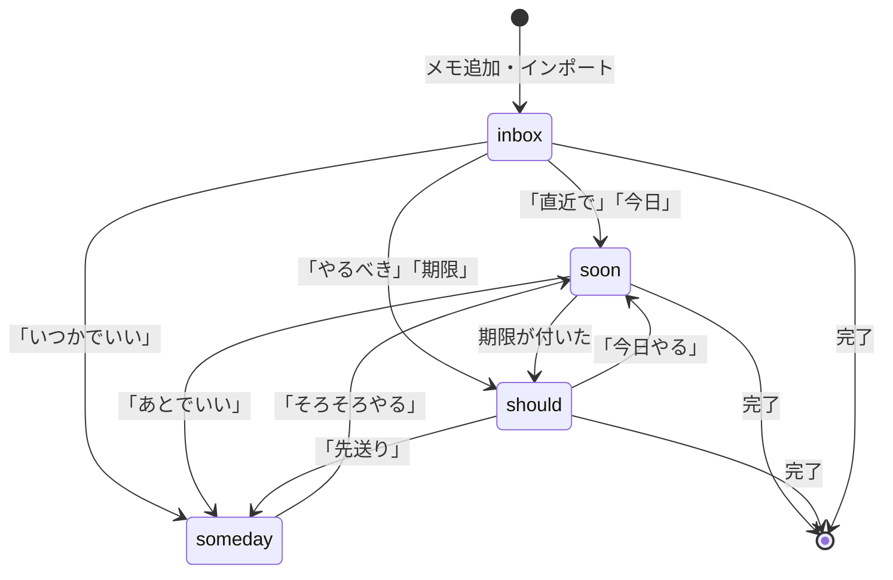

---

## 3. システム構成

### 3.1 全体

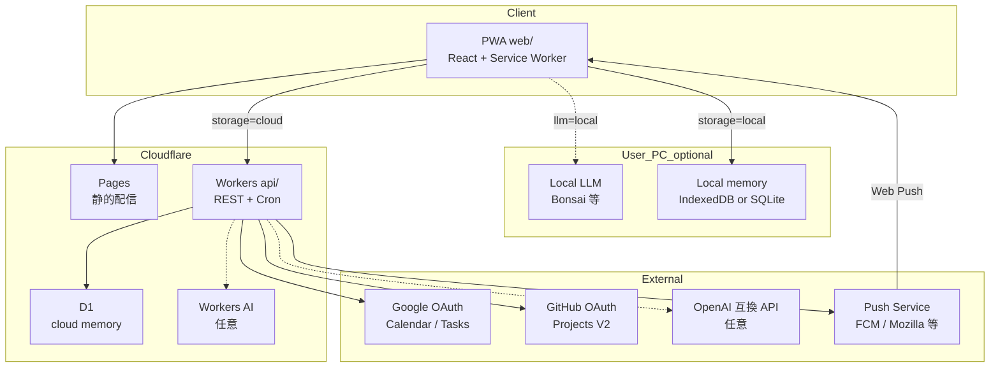

| 層 | 技術 | 役割 |
|----|------|------|
| FE | Cloudflare Pages（Vite + React PWA） | UI・Web Push・（任意）ローカル LLM / ローカル記憶 |
| BE | Cloudflare Workers | クラウド記憶時の API・OAuth・インポート・Cron |
| DB（cloud） | D1 | `storage_mode=cloud` の正本 |
| DB（local） | IndexedDB（PWA）または PC 上 SQLite | `storage_mode=local` の正本 |
| 定期 | Workers Cron または OS / SW ローカル通知 | ダイジェスト |
| LLM | Bonsai 等 / Workers AI / OpenAI / ヒューリスティック | 意図解釈。tool は選択中の記憶層へ |

### 3.2 頭脳と記憶の置き場所

方針: **推論（頭脳）とタスク（記憶）はそれぞれ独立に選べる**。組み合わせで「どこまで外に出すか」を決める。

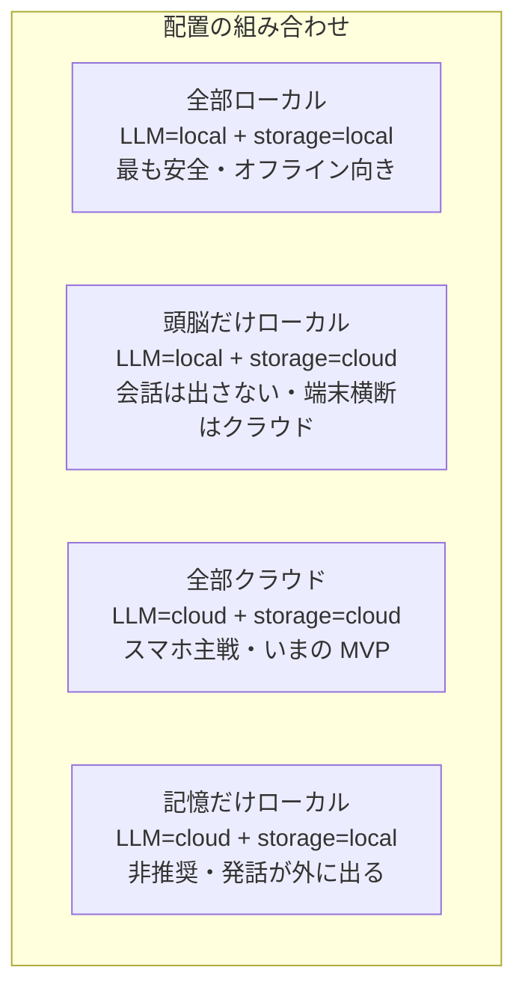

| | `storage=local` | `storage=cloud`（D1） |
|--|-----------------|----------------------|
| **`llm=local`** | PC 完結。安全・楽（ネット不要でもアシスタントが動く） | 会話はローカル、タスクはクラウド同期 |
| **`llm=cloud`** | 発話が外に出るので非推奨 | スマホ・外出先向け（現行） |
| **`llm=heuristic`** | オフライン最低限 | LLM なしでもクラウド記憶は使える |

**ローカル記憶の置き方（優先順）**

1. **PWA IndexedDB / OPFS** — 追加プロセスなし。同一ブラウザ内で完結。バックアップはエクスポート JSON
2. **PC サイドカー SQLite**（任意）— Bonsai と並べて `localhost` API。複数ブラウザ・ファイルバックアップが楽
3. **クラウド D1** — 端末横断・朝の Cron Push が簡単

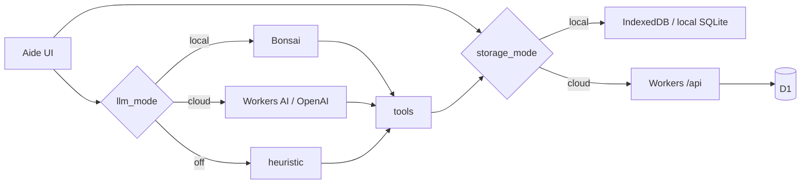

設定（予定）:

| 項目 | 例 |
|------|-----|
| `storage_mode` | `local` \| `cloud` |
| `llm_mode` | `auto` \| `local` \| `cloud` \| `heuristic` |
| `local_llm_base_url` | `http://127.0.0.1:8081/v1` |
| `local_llm_model` | `bonsai-4b` など |

`auto`（LLM）: ローカル疎通 → cloud → heuristic。  
同期（local ↔ cloud）は任意・後回し。まず **どちらか一方が正本** で運用する方が単純で安全。

### 3.3 リポジトリ

```
aide/
  api/          Workers + D1
    migrations/ D1 スキーマ
    src/
      auth/     セッション · OAuth
      secretary/ アシスタント（クラウド LLM / heuristic）
      import/   Google · GitHub
      push/     Web Push · ダイジェスト
      routes/   タスク · ボード
  web/          PWA フロント
    src/pages/  ホーム · ボード · アシスタント · 設定
    src/lib/    （予定）localSecretary — Bonsai 呼び出し
```

### 3.4 画面とデータ

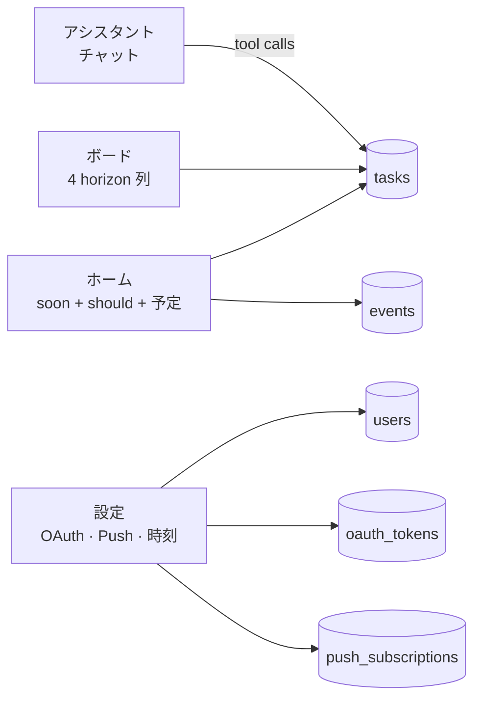

---

## 4. データモデル

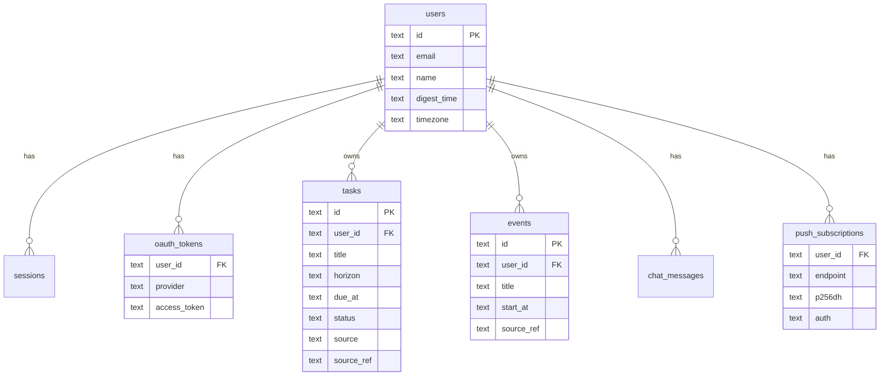

| エンティティ | 要点 |
|-------------|------|
| `tasks` | `horizon`: inbox/soon/should/someday · `source`: manual/google_*/github · `source_ref` で冪等インポート |
| `events` | Calendar 取込。ホーム表示。任意でタスク化 |
| `oauth_tokens` | provider = `google` \| `github`（ユーザーあたり 1） |
| `push_subscriptions` | endpoint 一意。Cron から送信 |
| `chat_messages` | アシスタントの直近履歴（コンテキスト用） |

正本スキーマ: [`api/migrations/0001_init.sql`](api/migrations/0001_init.sql)

---

## 5. シーケンス

### 5.1 認証（開発ログイン / OAuth）

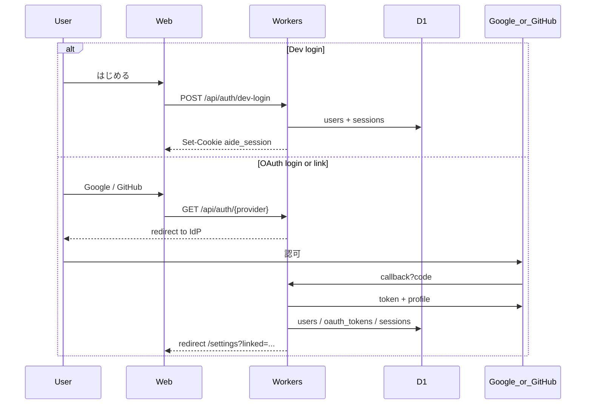

- Cookie: `aide_session`（HttpOnly · SameSite=Lax）
- ログイン済みで OAuth を開くと **link**（既存ユーザーにトークン紐付け）
- 未ログインだと **login**（ユーザー作成 + セッション）

### 5.2 アシスタントチャット（クラウド / heuristic）

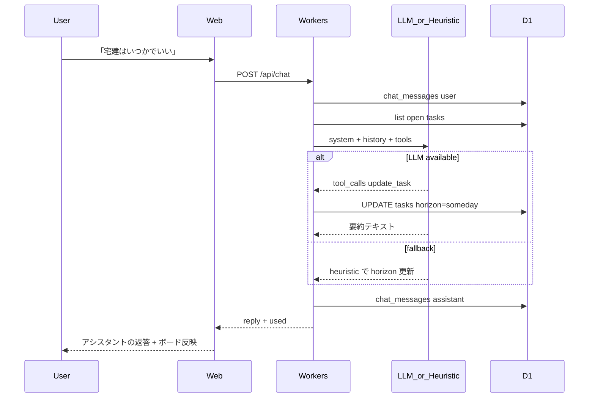

### 5.3 アシスタントチャット（ローカル LLM · Bonsai 等）

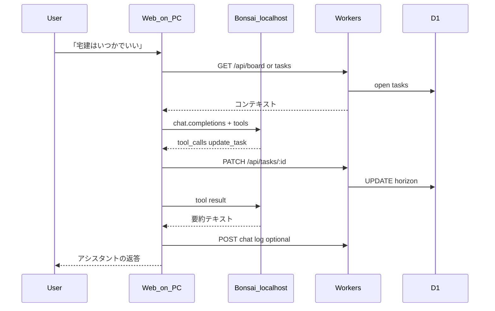

発話は PC 外に出ない。永続化先は `storage_mode`（local IndexedDB または cloud D1）。スマホでは LLM local は使わず 5.2 にフォールバック。

アシスタントが使ってよい tool:

| Tool | 効果 |
|------|------|
| `create_task` | タスク追加 |
| `update_task` | title / horizon / due 更新 |
| `list_by_horizon` | 一覧 |
| `complete_task` | status=done |

**禁止**: ユーザーが言っていない優先順位の自動付け。

解決順（`auto`）: **local（Bonsai 疎通）** → cloud（`OPENAI_API_KEY` / Workers AI）→ ヒューリスティック。

### 5.4 インポート

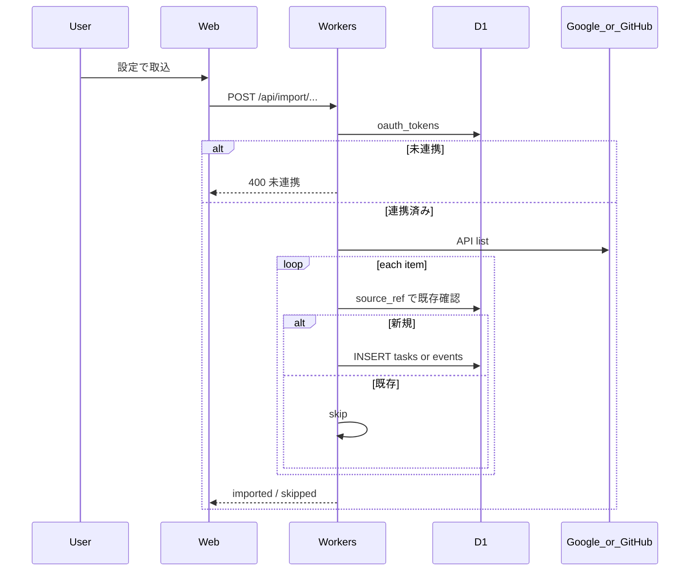

| エンドポイント | 先 | 結果の置き場 |
|----------------|----|--------------|
| `/api/import/google-tasks` | Google Tasks | `tasks`（due あり→`should`、なし→`inbox`） |
| `/api/import/google-calendar` | Calendar primary（2 週間） | `events` |
| `/api/import/github-projects` | Projects V2（`number` 指定） | `tasks` → `inbox` |

いずれも **読み取り専用**。`source_ref` で二重取込を避ける。

### 5.5 朝のダイジェスト（Web Push）

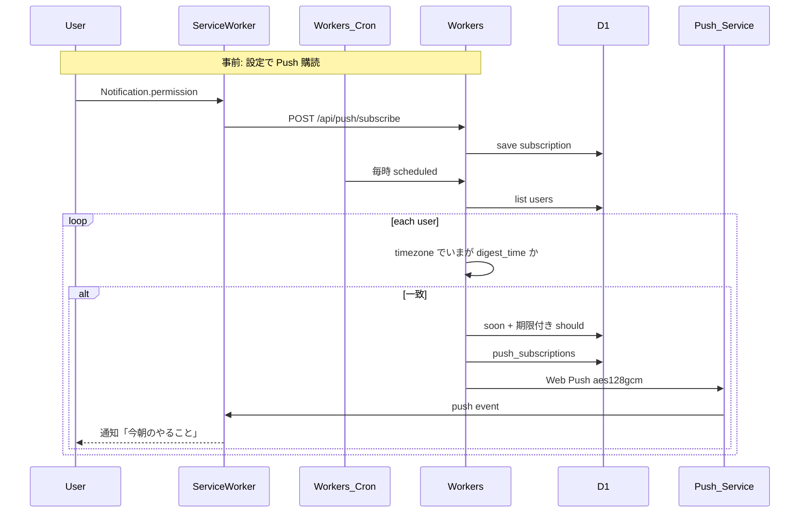

---

## 6. API 一覧（MVP）

| Method | Path | 説明 |
|--------|------|------|
| GET | `/api/health` | ヘルス |
| GET | `/api/auth/me` | ユーザー · 連携 · feature flags |
| POST | `/api/auth/dev-login` | 開発ログイン |
| POST | `/api/auth/logout` | ログアウト |
| GET | `/api/auth/google` · `/callback` | Google OAuth |
| GET | `/api/auth/github` · `/callback` | GitHub OAuth |
| GET | `/api/home` | 直近 · やるべき · 今日の予定 |
| GET | `/api/board` | 4 列ボード |
| GET/POST | `/api/tasks` | 一覧 / 作成 |
| PATCH/DELETE | `/api/tasks/:id` | 更新 / 完了 |
| GET | `/api/events` | 取込予定 |
| POST | `/api/events/:id/to-task` | 予定→タスク |
| GET/POST | `/api/chat` | 履歴 / アシスタント |
| PATCH | `/api/settings` | digest_time · timezone |
| POST | `/api/import/google-tasks` | Tasks 取込 |
| POST | `/api/import/google-calendar` | Calendar 取込 |
| POST | `/api/import/github-projects` | Projects 取込 |
| POST | `/api/push/subscribe` | Push 登録 |
| POST | `/api/push/unsubscribe` | 解除 |
| POST | `/api/push/test` | テスト送信 |

---

## 7. UX（画面）

1. **ホーム** — 今日の `soon` + 期限付き `should` + アシスタントへの短い入力
2. **ボード** — Inbox / 直近 / やるべき / いつか（確認・手動移動も可）
3. **アシスタント** — 会話スレッド。例: 「今日やることは？」「宅建はいつかでいい」「買い物を追加」
4. **設定** — OAuth 連携 · インポート · ダイジェスト時刻 · Web Push

---

## 8. スコープ

**MVP（実装済み）**

- 単体完結のタスク / メモ / アシスタント / ボード
- Google Tasks · Calendar · GitHub Projects インポート
- Web Push 朝ダイジェスト（Cron）
- クラウド LLM / ヒューリスティックアシスタント

**次（仕様済み · 未実装）**

- **ローカル LLM（Bonsai 等）**: Web → OpenAI 互換 localhost。tool は選択中の記憶層へ
- **ローカル記憶**: `storage_mode=local`（まず IndexedDB）。全部ローカルなら安全・オフラインで楽
- 設定 UI: `storage_mode` · `llm_mode` · `local_llm_base_url`
- **方向性**: アシスタントからいずれ **仲間** 寄りになる可能性（関係性・トーンの進化）
- **方向性**: タスク管理以外にも広がる可能性（メモ・予定・生活の補佐など）
- **カレンダーへの落とし込み**: 現状は Google Calendar **インポートのみ** → 書き戻し・予定化を将来スコープに含める

**v2 以降**

- Slack / LINE 通知
- Google Calendar / Tasks / GitHub への書き戻し（双方向同期・予定化）
- local ↔ cloud の任意同期・エクスポート／インポート
- ネイティブアプリ / PC サイドカー SQLite
- 優先度の自動ランキング
- スマホから自宅 PC（Bonsai + ローカル記憶）への中継

---

## 9. ローカル開発

```bash
# API
cd api
cp .dev.vars.example .dev.vars
npm install
npm run db:migrate:local
npm run dev                      # http://127.0.0.1:8790

# Web（別ターミナル）
cd web
npm install
npm run dev                      # http://127.0.0.1:5173 → /api を 8790 へプロキシ
```

`ALLOW_DEV_LOGIN=true` のとき、ログイン画面から開発用ユーザーを作成できる。

### 環境変数（`.dev.vars` / secrets）

| 名 | 用途 |
|----|------|
| `SESSION_SECRET` | セッション · OAuth state 署名 |
| `APP_URL` | フロント origin（OAuth redirect） |
| `ALLOW_DEV_LOGIN` | `true` で開発ログイン |
| `GOOGLE_CLIENT_ID` / `GOOGLE_CLIENT_SECRET` | Google OAuth |
| `GITHUB_CLIENT_ID` / `GITHUB_CLIENT_SECRET` | GitHub OAuth |
| `VAPID_PUBLIC_KEY` / `VAPID_PRIVATE_KEY` / `VAPID_SUBJECT` | Web Push |
| `OPENAI_API_KEY` · `OPENAI_BASE_URL` | 任意の OpenAI 互換 LLM |

```bash
npx web-push generate-vapid-keys
```

### デプロイ

1. `npx wrangler d1 create aide` → `api/wrangler.jsonc` の `database_id` を更新
2. `cd api && npm run db:migrate:remote && npm run deploy`
3. `cd web && npm run build` → Pages へ（`/api` は Workers へプロキシ）
4. OAuth / VAPID を `wrangler secret put` で設定
5. 本番で Workers AI を使う場合は `wrangler.jsonc` に `ai.binding` を追加
