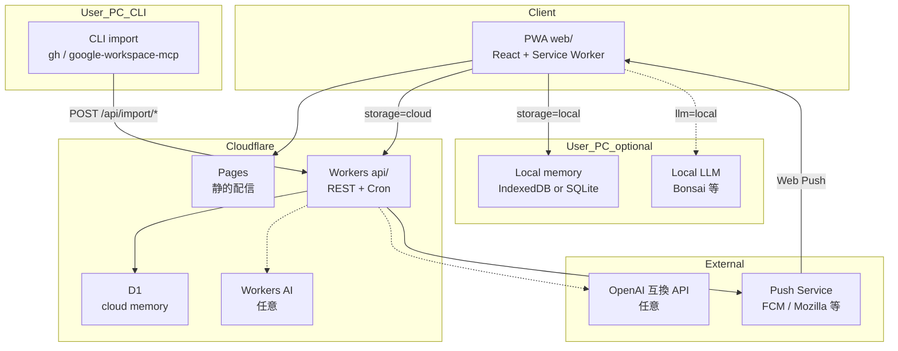
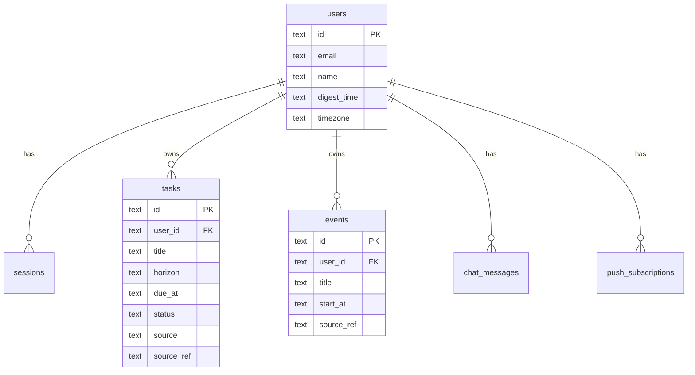
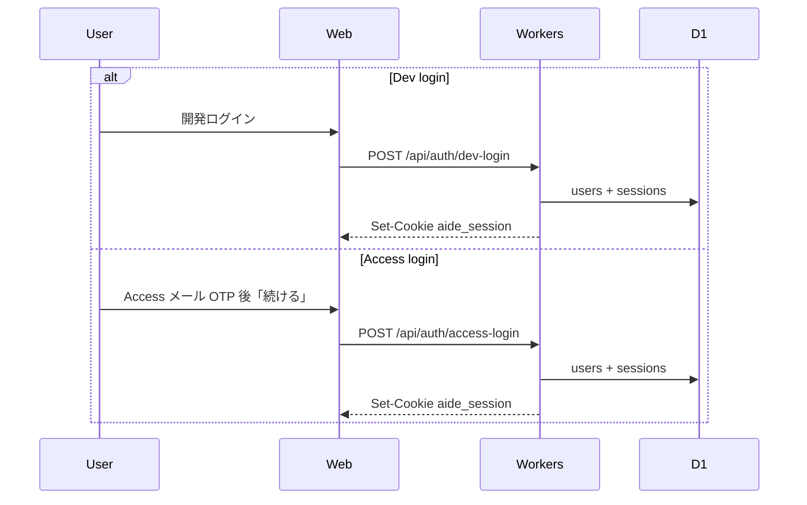
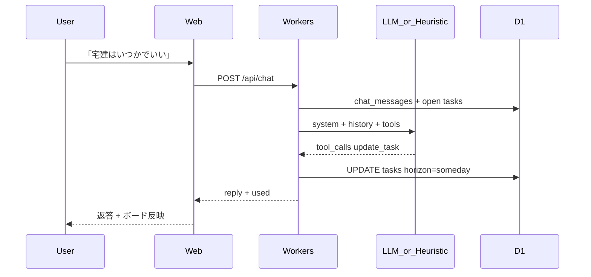
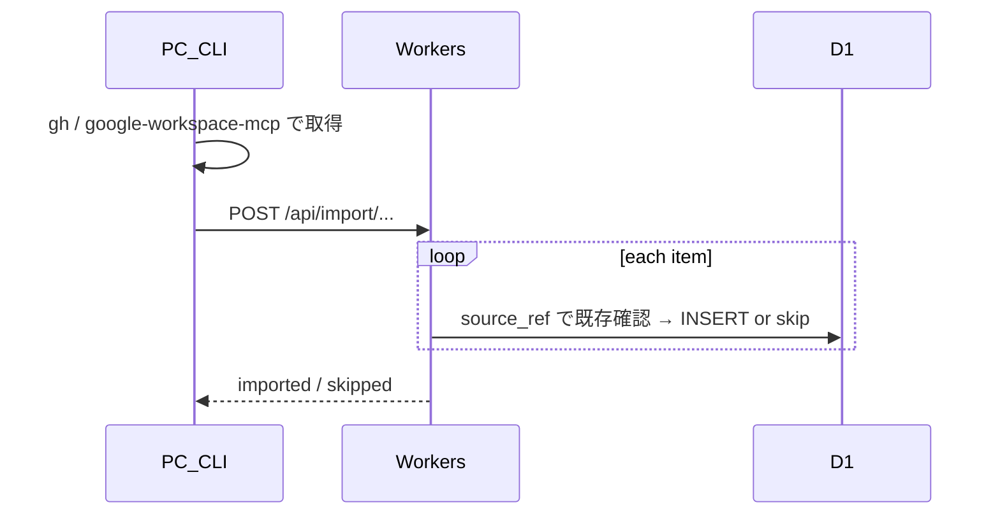

# Aide

**暮らしのアシスタント**（Aide = 補佐・助手）。読み取り専用。入力は Slack と Google カレンダー。

この README が MVP の仕様正本。以前の設計は [aide-design.md](aide-design.md)。実装は `api/` · `web/` を参照。

---

## 1. 原則

- **読み取り専用。入力は Slack と Google カレンダー。作業は手元（Cursorなど）。** — UI にも同じ一文（`web/src/lib/principle.ts`）
- **いま何をすべきか** — 画面は読み取り専用。一旦の入力は Slack と Google カレンダーのみ。勝手な優先順位は付けない
- **単体で動く** — 未連携でも一覧は見られる。**いまの入力は Slack と Google カレンダーのみ。画面は読み取り専用。** 取込はローカルの CLI（OAuth トークンを D1 に置かない）。将来はアプリで連携してセットアップできればよい
- **頭脳・記憶は選べる** — LLM もタスクデータもクラウド / ローカルを選択可（個人段階の「話す」は Cursor でよい）

---

## 2. ホームの見え方

ホームは **TODO / WANT / SCHEDULE**。label（GitHub 相当）で絞る。Google カレンダーから完全移行できたら SCHEDULE を2番目（TODO / SCHEDULE / WANT）にする。

| UI | 中身 | 保存 |
|----|------|------|
| **TODO** | やること（未仕分け含む） | `horizon`: inbox / soon / should |
| **WANT** | いつか・欲しい | `horizon`: someday |
| **SCHEDULE** | 時刻付き予定 | `events`（カレンダー） |

| 軸 | 役割 |
|----|------|
| **label / domain** | `assets` · `engineering` · `health` · `self` · `trip`。TODO / WANT を横断フィルタ |
| **priority** | 高 / 中 / 低。いまの見え方の中での並び（期限優先の次） |

DB の `horizon` は内部キー。画面では TODO / WANT に畳む。「来週でいい」などと言うと `horizon` / `due_at` を更新する。

---

## 3. システム構成

### 3.1 全体



| 層 | 技術 | 役割 |
|----|------|------|
| FE | Cloudflare Pages（Vite + React PWA） | UI・Web Push・（任意）ローカル LLM / ローカル記憶 |
| BE | Cloudflare Workers | クラウド記憶時の API・CLI 取込受け口・Cron |
| DB（cloud） | D1 | `storage_mode=cloud` の正本 |
| DB（local） | IndexedDB（PWA）または PC 上 SQLite | `storage_mode=local` の正本 |
| 定期 | Workers Cron または OS / SW ローカル通知 | ダイジェスト |
| LLM | Bonsai 等 / Workers AI / OpenAI / ヒューリスティック | 意図解釈。tool は選択中の記憶層へ |

### 3.2 頭脳と記憶

推論（頭脳）とタスク（記憶）は **それぞれ独立** に選べる。

| | `storage=local` | `storage=cloud`（D1） |
|--|-----------------|----------------------|
| **`llm=local`** | PC 完結。オフライン可 | 会話はローカル、タスクはクラウド |
| **`llm=cloud`** | 発話が外に出るので非推奨 | スマホ・外出先向け（現行 MVP） |
| **`llm=heuristic`** | オフライン最低限 | LLM なしでもクラウド記憶は使える |

ローカル記憶の優先: **IndexedDB / OPFS** → PC サイドカー SQLite（任意）→ クラウド D1。

| 設定 | 例 |
|------|-----|
| `storage_mode` | `local` \| `cloud` |
| `llm_mode` | `auto` \| `local` \| `cloud` \| `heuristic` |
| `local_llm_base_url` | `http://127.0.0.1:8081/v1` |

`auto`: ローカル疎通 → cloud → heuristic。local ↔ cloud 同期は任意・後回し（どちらか一方が正本）。

### 3.3 リポジトリ

```
aide/
  api/          Workers + D1
    migrations/ D1 スキーマ
    src/
      auth/     セッション · Access / 開発ログイン
      secretary/ アシスタント（クラウド LLM / heuristic）
      import/   md-lists（CLI 用）
      push/     Web Push · ダイジェスト
      routes/   タスク · ボード
  web/          PWA フロント
    src/pages/  メイン · ログイン
    src/lib/    （予定）localSecretary — Bonsai 呼び出し
```

---

## 4. データモデル



| エンティティ | 要点 |
|-------------|------|
| `tasks` | `horizon` · `domain`（label）· `priority` · `source` / `source_ref` で冪等インポート |
| `events` | Calendar 取込（CLI）。ホームの SCHEDULE。任意でタスク化 |
| `oauth_tokens` | スキーマ残存・未使用。D1 に OAuth を置かない。既存行は消してよい |
| `push_subscriptions` | endpoint 一意。Cron から送信 |
| `chat_messages` | アシスタントの直近履歴 |

正本スキーマ: [`api/migrations/0001_init.sql`](api/migrations/0001_init.sql)

---

## 5. シーケンス

### 5.1 認証



Cookie: `aide_session`（HttpOnly · SameSite=Lax）。**アプリ内 Google / GitHub OAuth は廃止**（410）。

### 5.2 アシスタントチャット



**ローカル LLM（Bonsai 等）**: 発話は Web → localhost。tool 結果は `storage_mode` 先（IndexedDB または D1）へ PATCH。スマホは 5.2 にフォールバック。

| Tool | 効果 |
|------|------|
| `create_task` | タスク追加 |
| `update_task` | title / horizon / due 更新 |
| `list_by_horizon` | 一覧 |
| `complete_task` | status=done |

### 5.3 インポート · Push



| 取込 | CLI（keitaro-yamaguchi） | API | 結果 |
|------|--------------------------|-----|------|
| Google Tasks | `python3 .agent/scripts/import_google_tasks_to_aide.py --execute` | `POST /api/import/md-lists` | `tasks`（`source=md_list`） |
| Google Calendar | `python3 .agent/scripts/import_google_calendar_to_aide.py --execute` | `POST /api/import/events` | `events`（`source_ref=gcal:…` 冪等 · 今日から7日） |
| GitHub Projects | `python3 .agent/scripts/import_projects_to_aide.py --execute` | `POST /api/import/md-lists` | `tasks`（`source=md_list`） |
| md リスト | `python3 .agent/scripts/import_md_lists_to_aide.py --execute` | `POST /api/import/md-lists` | `tasks` → 既定 `someday`（`source=md_list` 冪等） |

アプリ内 `/api/import/google*` · `github-projects` は **410**（D1 に OAuth を置かない）。

**朝ダイジェスト**: Cron が timezone + `digest_time` 一致ユーザーの `soon` / 期限付き `should` を Web Push 送信。事前に `POST /api/push/subscribe`。

---

## 6. API 一覧（MVP）

| Method | Path | 説明 |
|--------|------|------|
| GET | `/api/health` | ヘルス |
| GET | `/api/auth/me` | ユーザー · feature flags |
| POST | `/api/auth/dev-login` | 開発ログイン |
| POST | `/api/auth/access-login` | Access OTP 後のセッション発行 |
| POST | `/api/auth/logout` | ログアウト |
| GET | `/api/home` | 直近 · やるべき · 今日の予定 |
| GET | `/api/board` | 4 列ボード |
| GET/POST | `/api/tasks` | 一覧 / 作成 |
| PATCH/DELETE | `/api/tasks/:id` | 更新 / 完了 |
| GET | `/api/events` | 取込予定 |
| POST | `/api/events/:id/to-task` | 予定→タスク |
| GET/POST | `/api/chat` | 履歴 / アシスタント |
| PATCH | `/api/settings` | digest_time · timezone |
| POST | `/api/import/md-lists` | md リスト冪等取込（body: `{ items }` · CLI 用） |
| POST | `/api/import/events` | Calendar 冪等取込（body: `{ items: [{ title, source_ref, start_at, end_at }] }` · CLI 用） |
| POST | `/api/push/subscribe` | Push 登録 |
| POST | `/api/push/unsubscribe` | 解除 |
| POST | `/api/push/test` | テスト送信 |

廃止（410）: `/api/auth/google` · `/callback`、`/api/auth/github` · `/callback`、`/api/import/google*` · `github-projects`

---

## 7. 画面

**ホームだけ** — **TODO / WANT / SCHEDULE**＋label フィルタ。ボードは置かない。SCHEDULE を2番目にするのはカレンダー完全移行のあと。

**設定ボタンは置かない。** ダイジェスト · Push · ログアウトの画面はない。

---

## 8. スコープ

**MVP（実装済み）** — 1ページ UI、タスク / メモ / アシスタント、CLI 取込（Google Tasks · GitHub Projects · md リスト。Calendar は未）、Web Push 朝ダイジェスト、クラウド LLM / ヒューリスティック。認証は個人用のみ（本番は Access のメール認証、ローカルは登録メール）

**次** — 登録してユーザーごとのマイページ、アプリでの連携・セットアップ（いまはローカルのみ）、ローカル LLM（Bonsai）・ローカル記憶（IndexedDB）、設定 UI（`storage_mode` / `llm_mode`）、**仲間** 寄りの関係性、Calendar の完全移行後に SCHEDULE を2番目へ、**カレンダー書き戻し**

**v2 以降** — Slack / LINE 通知、双方向同期、local ↔ cloud 同期、ネイティブ / サイドカー SQLite

---

## 9. ローカル開発

```bash
# API
cd api
cp .dev.vars.example .dev.vars
npm install
npm run db:migrate:local
npm run dev                      # http://127.0.0.1:8790

# Web（別ターミナル）
cd web
npm install
npm run dev                      # http://127.0.0.1:5180 → /api を 8790 へプロキシ
```

`ALLOW_DEV_LOGIN=true` のローカルは登録メールで入る（個人用のみ）。本番は Access のメール OTP → 「続ける」（`POST /api/auth/access-login`）。

### 取込（CLI · 手元トークン）

keitaro-yamaguchi 側:

- Google Tasks: `python3 .agent/scripts/import_google_tasks_to_aide.py --execute`
- GitHub Projects: `python3 .agent/scripts/import_projects_to_aide.py --execute`
- md リスト: `python3 .agent/scripts/import_md_lists_to_aide.py --execute`
- Google Calendar: `python3 .agent/scripts/import_google_calendar_to_aide.py --execute`（今日から7日 · `POST /api/import/events`）

認証は `gh` / `~/.config/google-workspace-mcp/`（PC のみ）。aide の D1 には載せない。

### 環境変数

| 名 | 用途 |
|----|------|
| `SESSION_SECRET` | セッション署名 |
| `APP_URL` | フロント origin（`http://127.0.0.1:5180`） |
| `ALLOW_DEV_LOGIN` | 開発ログイン |
| `OWNER_EMAIL` | Access「続ける」· 自動化の対象ユーザー |
| `AUTOMATION_TOKEN` | 取込スクリプト用。`X-Aide-Automation-Token` ヘッダで送る |
| `VAPID_*` | Web Push（任意） |
| `OPENAI_API_KEY` · `OPENAI_BASE_URL` | 任意 LLM |

### デプロイ

1. `npx wrangler d1 create aide` → `api/wrangler.jsonc` の `database_id` 更新
2. `cd api && npm run db:migrate:remote && npm run deploy`
3. `cd web && npm run build` → Pages（`/api` は Workers へプロキシ）
4. `OWNER_EMAIL` · `SESSION_SECRET` ·（任意）VAPID を `wrangler secret put`
5. Workers AI 利用時は `wrangler.jsonc` に `ai.binding` 追加
6. 公開 URL の Access 保護: `./infra/apply.fish`（手順は [`infra/README.md`](infra/README.md)）

### Access（Cloudflare Zero Trust）

本番 Pages（`https://aide-1ll.pages.dev` · preview `*.aide-1ll.pages.dev`）と API 直叩き（`https://aide-api.keitaro-cryptocurrency.workers.dev`）は **Cloudflare Access の背後**にある。ブラウザでは許可メールへの OTP ログイン。import スクリプト等は Access セッション / Service Token が要るか、ブラウザ認証後の Pages 経由で叩く。

**認証**: 一旦は個人用のみ。本番は Access のメール OTP → 「続ける」（`POST /api/auth/access-login`）。ローカルは登録メール（`POST /api/auth/owner-login`）。将来は登録してユーザーごとのマイページ。**アプリ内 Google / GitHub OAuth は廃止**（410）。

**取込**: PC の CLI（`gh` · `google-workspace-mcp` の手元トークン → aide API）。D1 に OAuth を置かない。既存 `oauth_tokens` 行は消してよい。

門は 2 つ（Access＝URL、aide セッション＝誰のタスクか）:

| | 誰を通すか | 自動化での渡し方 |
|--|-----------|-----------------|
| Cloudflare Access | 許可メール · Service Token | `CF-Access-Client-Id` / `CF-Access-Client-Secret` |
| aide のセッション | Access の続き · ローカルの登録メール | `X-Aide-Automation-Token`（= `AUTOMATION_TOKEN`） |
