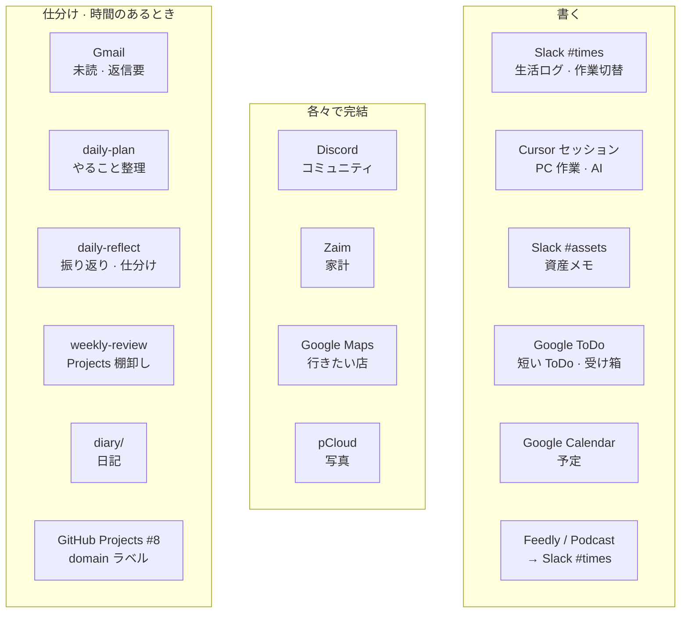
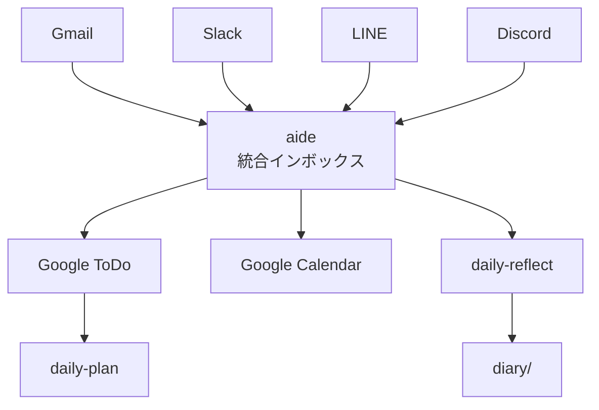

# aide — 学習型情報統合アシスタント設計

## いま

一旦の入力は Slack と Google カレンダーのみ。aide は読み取り専用（**TODO / WANT / SCHEDULE**。label で絞る）。SCHEDULE は Google カレンダーから完全移行できたら 2 番目。

- セットアップと連携はローカル（PC の CLI）。OAuth トークンは D1 に置かない。将来はアプリで連携してセットアップ
- 認証は一旦個人用のみ。本番は Access のメール認証。ローカルは登録メール。将来は登録してユーザーごとのマイページ
- engineering は techblog、works と self は blog で公開できるとよい
- 実装の正本は [aide の README](https://github.com/keitaroooo/aide)。このファイルのこれ以降は、チャネルを 1 画面に集める以前の設計

## コンセプト

**「情報の取捨選択を学習し、すべてのコミュニケーションを1つのインターフェイスで管理する」**

現状、LINE・メール・Discord・Slack など複数のチャネルが分散しており、それぞれで情報を探し、優先度を判断し、対応する必要がある。aide は以下を実現する:

1. **統合インターフェイス** — すべてのチャネル（LINE・Gmail・Discord・Slack など）を1画面で管理
2. **学習型フィルタリング** — ユーザーの行動（既読・返信・スキップ・アーカイブ）から優先度を学習
3. **自動トリアージ** — 重要・緊急・後で・不要を AI が分類・提案
4. **アクション提案** — 「返信が必要」「ToDo化すべき」「カレンダーに入れる」などを自動検出

---

## 情報フローの現状と課題

### 現在の情報フロー（README.md より）



### 課題

| 課題 | 現状 | aide での解決 |
|------|------|---------------|
| **チャネル分散** | LINE・Gmail・Discord を個別に開いて確認 | 統合ダッシュボードで一覧 |
| **優先度判断の負荷** | 都度、自分で重要度を判断 | AI が過去の行動から学習・提案 |
| **見落とし** | 未読が溜まると重要なものを見逃す | 緊急度・重要度で自動ソート |
| **ToDo・カレンダー連携** | 手動でコピペ・登録 | ワンタップで ToDo 化・予定化 |
| **振り返りの手間** | daily-reflect で手動で振り返り | AI が自動で「今日対応したもの」を要約 |

---

## 機能設計

### 1. 統合インボックス

すべてのメッセージを時系列・優先度順で表示。

#### 対応チャネル

- **Phase 1（MVP）**
  - Gmail（API）
  - Slack（Bot API / OAuth）
  - Google ToDo（API）
  - Google Calendar（API）

- **Phase 2**
  - LINE（Messaging API / LIFF）
  - Discord（Bot / Webhook）
  - Notion（API）— メモ・データベース参照

#### 表示項目

| 項目 | 説明 |
|------|------|
| チャネル | アイコン（Gmail / Slack / LINE など） |
| 送信者 | 名前 |
| 件名 / 最初の1行 | メッセージのサマリー |
| 受信日時 | 相対時間（5分前 / 昨日 / 1週間前） |
| 優先度スコア | AI 推定（緊急 / 重要 / 通常 / 低） |
| ステータス | 未読 / 既読 / 返信済み / ToDo化済み / アーカイブ |
| 推奨アクション | 「返信」「ToDo化」「予定追加」「スキップ」 |

---

### 2. 学習型フィルタリング

ユーザーの行動を記録し、優先度判定モデルを更新。

#### 学習対象の行動

| 行動 | 重み | 学習内容 |
|------|------|----------|
| **すぐに開いた** | +10 | このチャネル・送信者・キーワードは重要 |
| **返信した** | +20 | 高優先度 |
| **ToDo化した** | +15 | アクション必要 |
| **カレンダーに追加** | +10 | スケジュール関連は重要 |
| **既読スキップ** | -5 | 低優先度 |
| **未読のまま放置（1週間）** | -10 | ノイズの可能性 |
| **アーカイブ** | -3 | 後で見る（が、緊急ではない） |
| **削除** | -20 | 不要 |

#### 学習モデル

- **初期**: ルールベース（件名に「緊急」「至急」「Re:」が含まれる → 高優先度）
- **Phase 2**: 機械学習（送信者・時間帯・キーワード・過去の行動から優先度を予測）
  - モデル例: ロジスティック回帰 → LightGBM → Transformer（将来）
  - 学習データ: `(message_features, user_action) → priority_score`

#### プライバシー配慮

- 学習はローカル（D1 / IndexedDB）で完結
- メッセージ本文は Cloudflare Workers AI で処理（ログ保存なし）
- 送信先への共有はなし

---

### 3. 自動トリアージ

AI が各メッセージを分類・提案。

#### 分類カテゴリ

| カテゴリ | 定義 | 推奨アクション |
|----------|------|----------------|
| **🔴 緊急・重要** | 今日中に対応が必要 | すぐ返信 or ToDo化 |
| **🟡 重要・非緊急** | 今週中に対応 | ToDo化 |
| **🟢 非重要・緊急** | 簡単に処理可能 | その場で処理 |
| **⚪ 非重要・非緊急** | 情報共有・雑談 | 既読 or アーカイブ |
| **🗑️ ノイズ** | 広告・スパム | 削除 or フィルタ登録 |

#### AI 判定ロジック（Phase 1）

```
IF 送信者 in VIP_LIST:
  priority = "緊急・重要"
ELSE IF "緊急" OR "至急" in 件名:
  priority = "緊急"
ELSE IF "予定" OR "日程" in 本文:
  action = "カレンダー追加"
ELSE IF "タスク" OR "TODO" in 本文:
  action = "ToDo化"
ELSE IF 未読日数 > 7:
  priority = "低"
ELSE:
  priority = "通常"
```

#### AI 判定ロジック（Phase 2）

- Workers AI（Llama 3.3 / Claude など）で意図理解
  - 「依頼」「質問」「情報共有」「雑談」を分類
  - 「〇〇日までに」「いつまでに」を抽出 → 期限として認識
- ベクトル検索（Vectorize）で類似過去メッセージから優先度を推定

---

### 4. アクション提案

メッセージごとに「次にすべきこと」を提案。

| 提案 | トリガー条件 | 動作 |
|------|--------------|------|
| **返信** | 質問・依頼が含まれる | テンプレート提示（AI生成） |
| **ToDo化** | 「〇〇してください」「お願いします」 | ワンタップで Google ToDo へ登録 |
| **予定追加** | 日時が含まれる | Google Calendar へ自動追加 |
| **スキップ** | 雑談・情報共有のみ | 既読にして次へ |
| **アーカイブ** | 重要だが今は不要 | 検索可能な状態で保存 |
| **削除** | 明らかなスパム | 完全削除 + フィルタ登録 |

#### 返信テンプレート生成（Phase 2）

- Workers AI で「返信文案」を自動生成
  - 相手のメッセージから意図を理解
  - ユーザーの過去の返信スタイルを学習
  - 「承知しました」「確認します」「〇〇日までに対応します」などを提案

---

### 5. 振り返り支援

daily-reflect の自動化。

#### 機能

| 機能 | 説明 |
|------|------|
| **今日の対応サマリー** | 「返信したメッセージ 5件」「ToDo化 3件」「スキップ 10件」 |
| **未対応アラート** | 「重要メッセージが 2件未読です」 |
| **週次レポート** | 「今週は Gmail 30件、Slack 50件、LINE 10件を処理」 |
| **行動分析** | 「返信が遅れがちな送信者: 〇〇さん」 |

#### daily-reflect との連携

- aide から「今日の振り返り」を Markdown 出力
- `diary/2026H1.md` へ自動追記（オプション）

---

## 技術スタック

### フロントエンド

| 技術 | 理由 |
|------|------|
| **Next.js (App Router)** | SSR・SSG・ISR に対応、TypeScript ベース |
| **Tailwind CSS** | 高速開発、レスポンシブ対応 |
| **shadcn/ui** | モダンな UI コンポーネント |
| **React Query** | API キャッシュ・自動再取得 |
| **IndexedDB (Dexie.js)** | ローカルストレージ（オフライン対応） |

### バックエンド

| 技術 | 理由 |
|------|------|
| **Cloudflare Workers** | サーバーレス、エッジ実行 |
| **Cloudflare D1** | SQLite ベースの軽量 DB |
| **Cloudflare Workers AI** | 推論（優先度判定・返信文生成） |
| **Cloudflare Vectorize** | ベクトル検索（類似メッセージ検索） |
| **Cloudflare Queues** | バックグラウンド処理（メール取得など） |
| **Hono** | Workers 向け軽量フレームワーク |

### 外部 API 連携

| サービス | 用途 | 認証 |
|----------|------|------|
| **Gmail API** | メール取得・送信 | OAuth 2.0 |
| **Slack API** | メッセージ取得・投稿 | OAuth 2.0 + Bot Token |
| **LINE Messaging API** | メッセージ送受信 | Channel Access Token |
| **Discord API** | メッセージ取得 | Bot Token |
| **Google Calendar API** | 予定取得・登録 | OAuth 2.0 |
| **Google Tasks API** | ToDo 取得・登録 | OAuth 2.0 |

---

## データ設計

### D1 テーブル

#### messages

| カラム | 型 | 説明 |
|--------|------|------|
| id | TEXT PRIMARY KEY | UUID |
| channel | TEXT | "gmail" / "slack" / "line" / "discord" |
| channel_message_id | TEXT | 各チャネルでのメッセージ ID |
| sender_id | TEXT | 送信者 ID |
| sender_name | TEXT | 送信者名 |
| subject | TEXT | 件名（メールの場合） |
| body | TEXT | 本文 |
| received_at | INTEGER | 受信日時（UNIX timestamp） |
| priority_score | REAL | 優先度スコア（0.0 - 1.0） |
| status | TEXT | "unread" / "read" / "replied" / "archived" / "deleted" |
| user_action | TEXT | "opened" / "replied" / "skipped" / "todo" / "calendar" |
| action_at | INTEGER | アクション実行日時 |
| created_at | INTEGER | 登録日時 |
| updated_at | INTEGER | 更新日時 |

#### user_preferences

| カラム | 型 | 説明 |
|--------|------|------|
| user_id | TEXT PRIMARY KEY | ユーザー ID |
| vip_senders | TEXT | VIP 送信者リスト（JSON） |
| filters | TEXT | フィルタリングルール（JSON） |
| learning_enabled | INTEGER | 学習機能の有効化（0 / 1） |
| created_at | INTEGER | 登録日時 |
| updated_at | INTEGER | 更新日時 |

#### learning_events

| カラム | 型 | 説明 |
|--------|------|------|
| id | TEXT PRIMARY KEY | UUID |
| message_id | TEXT | 対象メッセージ ID |
| action | TEXT | "opened" / "replied" / "skipped" / "todo" / "calendar" / "archived" / "deleted" |
| action_at | INTEGER | アクション実行日時 |
| created_at | INTEGER | 登録日時 |

---

## 開発フェーズ

### Phase 1: MVP（統合インボックス + ルールベース優先度）

- [ ] Gmail API 連携（受信メール一覧取得）
- [ ] Slack API 連携（チャネル・DM 一覧取得）
- [ ] 統合インボックス UI（Next.js + shadcn/ui）
- [ ] ルールベース優先度判定（件名・送信者で分類）
- [ ] ユーザーアクション記録（既読・返信・スキップ・アーカイブ）
- [ ] 基本的なフィルタリング（未読のみ・チャネル別）

### Phase 2: 学習機能 + AI 分類

- [ ] 学習モデル実装（LightGBM / ロジスティック回帰）
- [ ] Workers AI 連携（意図理解・返信文生成）
- [ ] Vectorize 連携（類似メッセージ検索）
- [ ] 自動トリアージ（緊急・重要度の自動分類）
- [ ] 返信テンプレート生成

### Phase 3: アクション統合

- [ ] Google Calendar API 連携（予定自動登録）
- [ ] Google Tasks API 連携（ToDo 自動登録）
- [ ] LINE Messaging API 連携
- [ ] Discord Bot 連携
- [ ] 振り返りレポート生成（日次・週次）

### Phase 4: 高度な学習 + プロアクティブ提案

- [ ] Transformer ベースモデル（BERT / GPT）
- [ ] 「今日やるべきこと」を朝に自動提案
- [ ] 「返信が遅れている相手」をアラート
- [ ] 「いつか対応する」メッセージの再通知

---

## UI/UX 設計

### 画面構成

```
┌─────────────────────────────────────────────┐
│ 🏠 aide                     [設定] [ログアウト] │
├─────────────────────────────────────────────┤
│ 📥 インボックス (42)  📌 VIP (3)  ✅ 完了 (120) │
├─────────────────────────────────────────────┤
│ フィルタ: [すべて▼] [未読のみ] [今日]        │
├─────────────────────────────────────────────┤
│ 🔴 [Gmail] 山田太郎 <yamada@example.com>      │
│    件名: 【緊急】明日の打ち合わせについて       │
│    本文: お世話になっております。明日...       │
│    📅 3時間前  💬 返信  ✅ ToDo  📌 VIP        │
├─────────────────────────────────────────────┤
│ 🟡 [Slack] #times                            │
│    佐藤さん: 今日のタスク進捗どうですか?      │
│    📅 5時間前  💬 返信  ⏭️ スキップ           │
├─────────────────────────────────────────────┤
│ 🟢 [LINE] 鈴木花子                           │
│    今度ご飯行きませんか?                      │
│    📅 昨日  💬 返信  ⏭️ スキップ              │
├─────────────────────────────────────────────┤
│ ⚪ [Discord] #雑談                           │
│    田中: おはようございます!                  │
│    📅 2日前  ⏭️ スキップ  🗑️ 削除            │
└─────────────────────────────────────────────┘
```

### インタラクション

| 操作 | 動作 |
|------|------|
| **スワイプ右** | 既読 |
| **スワイプ左** | アーカイブ |
| **長押し** | 詳細アクション（返信・ToDo化・削除） |
| **ダブルタップ** | 元のアプリで開く（Gmail / Slack など） |

---

## セキュリティ・プライバシー

| 項目 | 対策 |
|------|------|
| **OAuth 2.0** | Gmail・Slack・Google Calendar の認証 |
| **トークン保存** | Cloudflare Workers Secrets に暗号化保存 |
| **通信暗号化** | すべて HTTPS |
| **ログ保存** | メッセージ本文は Workers AI 処理後に破棄 |
| **データ削除** | ユーザーがいつでもアカウント削除可能 |

---

## keitaro-yamaguchi リポジトリとの連携

### 現在の workflows との統合

| workflow | aide での対応 |
|----------|---------------|
| **daily-plan** | aide が「今日やるべきメッセージ」を抽出 → Google ToDo へ自動登録 |
| **daily-reflect** | aide が「今日対応したメッセージ」を要約 → `diary/` へ出力（オプション） |
| **weekly-review** | aide が週次レポート生成 → 「未対応の重要メッセージ」をリストアップ |

### README.md への反映

- 「情報の流れ」の図に aide を追加:



---

## 次のステップ

未着手。いまの正本は上の「いま」。以下は以前の統合インボックス案。

1. **MVP 開発**
   - Gmail + Slack 連携の実装
   - 統合インボックス UI 構築
   - ルールベース優先度判定

2. **ローカルテスト**
   - `~/ghq/github.com/keitaroooo/aide` でローカル開発
   - Cloudflare Workers / D1 / Pages でデプロイ

3. **フィードバック収集**
   - 自分で1週間使ってみて、優先度判定の精度を確認
   - 「見落とし」「ノイズ」がどれくらいあるかを記録

4. **学習機能の実装**
   - ユーザーアクションを記録
   - 機械学習モデルの学習・更新

5. **他チャネルの追加**
   - LINE・Discord の連携
   - Google Calendar・ToDo の自動登録

---

## 参考リンク

- [Gmail API](https://developers.google.com/gmail/api)
- [Slack API](https://api.slack.com/)
- [LINE Messaging API](https://developers.line.biz/ja/services/messaging-api/)
- [Discord API](https://discord.com/developers/docs/intro)
- [Cloudflare Workers AI](https://developers.cloudflare.com/workers-ai/)
- [Cloudflare D1](https://developers.cloudflare.com/d1/)
- [Cloudflare Vectorize](https://developers.cloudflare.com/vectorize/)
